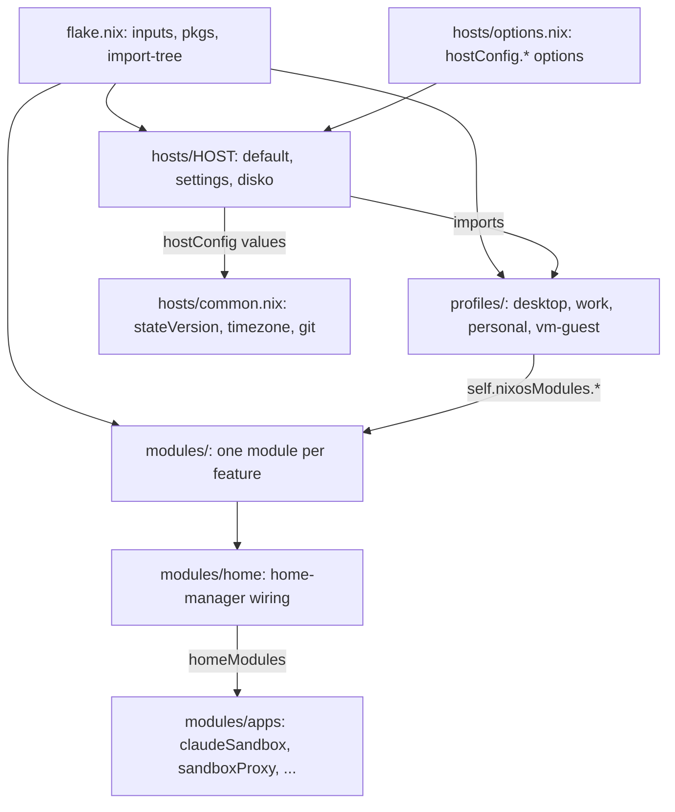
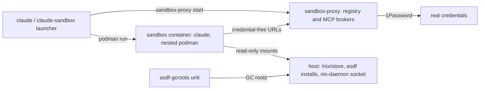

# Architecture

The repo is a NixOS flake built with flake-parts and `import-tree` (the
"dendritic" pattern). Every `.nix` file under `hosts/`, `profiles/` and `modules/`
is itself a flake-parts module. Fine-grained modules expose
`flake.nixosModules.<name>` (or `flake.homeModules.<name>`), profiles import
several of them, and hosts compose profiles. There is no top-level
`configuration.nix`. See [`AGENTS.md`](../AGENTS.md) for the conventions.

## Layers

- **Hosts** (`hosts/<host>/`): `default.nix` builds the `nixosConfiguration`,
  `settings.nix` sets the `hostConfig.*` values (user, timezone, git identity),
  `disko.nix` describes the disk. `framework-work` and `framework-personal` run on
  real hardware, `vm` is the throwaway test machine.
- **Profiles** (`profiles/`): `desktop` is the common base. `work` adds corporate
  tools and asdf plugins, `personal` adds Steam, `vm-guest` adapts a profile to VM
  hardware. `vm` imports `work`, so it has the same software as `framework-work`.
- **Modules** (`modules/`): one feature each. A feature with several files
  (scripts, config, source) gets its own directory with everything co-located.
  Modules reference each other as `self.nixosModules.<name>`, never by path.
- **Per-host values** go through `hostConfig.*` (declared in `hosts/options.nix`),
  so shared modules never hardcode a user name or email.

## Sandboxed tooling

The pieces that run AI tooling and developer tools without trusting them with the
host live under `modules/apps/`:

| Component | Where | Page |
| --- | --- | --- |
| claude-sandbox | `modules/apps/claude/` | [claude-sandbox](./claude-sandbox.md) |
| sandbox-proxy | `modules/apps/sandbox-proxy/` | [sandbox-proxy](./sandbox-proxy.md) |
| asdf-gcroots | `modules/apps/asdf/` | [asdf-gcroots](./asdf-gcroots.md) |
| claude-code settings and hooks | `modules/apps/claude/claude-code.nix` | [claude-notifications](./claude-notifications.md) |
| claude-tickets wiring | `modules/apps/claude-tickets.nix` | [claude-tickets](./claude-tickets.md) |
| herdr and ttt | `modules/apps/herdr.nix`, `ttt.nix` | [terminal-tools](./terminal-tools.md) |
| checks and builds | `flake.nix`, `*-check.nix` | [building-and-checking](./building-and-checking.md) |

`npm-sandbox` (`modules/apps/npm-sandbox/`) is the sibling sandbox for npm
installs. It shares the registry proxy but, unlike claude-sandbox, never joins the
MCP network.
