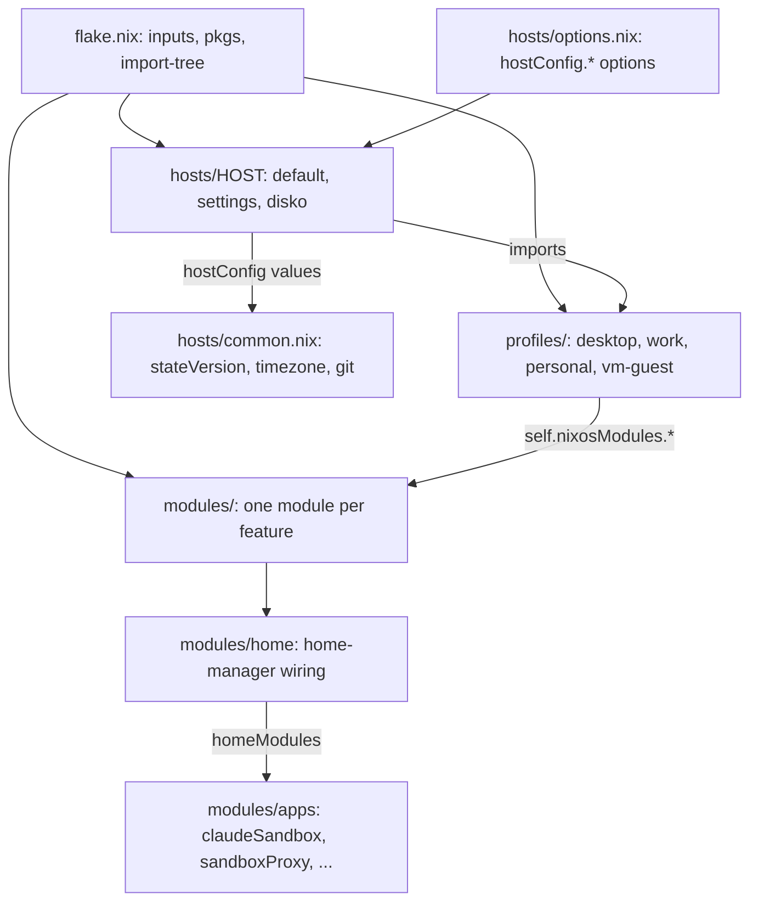
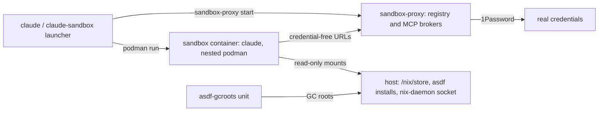

# Architecture

The repo is a NixOS flake built with flake-parts and `import-tree` (the
"dendritic" pattern). Every `.nix` file under `hosts/`, `profiles/` and `modules/`
is itself a flake-parts module. Fine-grained modules expose
`flake.nixosModules.<name>` (or `flake.homeModules.<name>`), profiles import
several of them, and hosts compose profiles. There is no top-level
`configuration.nix`. See [`AGENTS.md`](../AGENTS.md) for the conventions.

## Layers

- **Hosts** (`hosts/<host>/`): `default.nix` builds the `nixosConfiguration`,
  `settings.nix` sets the `hostConfig.*` values (user, timezone, git identity),
  `disko.nix` describes the disk. `framework-work` and `framework-personal` run on
  real hardware, `vm` is the throwaway test machine.
- **Profiles** (`profiles/`): `desktop` is the common base. `work` adds corporate
  tools and asdf plugins, `personal` adds Steam, `vm-guest` adapts a profile to VM
  hardware. `vm` imports `work`, so it has the same software as `framework-work`.
- **Modules** (`modules/`): one feature each. A feature with several files
  (scripts, config, source) gets its own directory with everything co-located.
  Modules reference each other as `self.nixosModules.<name>`, never by path.
- **Per-host values** go through `hostConfig.*` (declared in `hosts/options.nix`),
  so shared modules never hardcode a user name or email.

## Sandboxed tooling

The pieces that run AI tooling and developer tools without trusting them with the
host live under `modules/apps/`:

| Component | Where | Page |
| --- | --- | --- |
| claude-sandbox | `modules/apps/claude/` | [claude-sandbox](./claude-sandbox.md) |
| kiro-sandbox | `modules/apps/kiro/` (runs claude-sandbox's launcher) | [kiro-sandbox](./kiro-sandbox.md) |
| agent accounts (`agent`, `agent-open`, `agent-configure`) | `modules/apps/agents/` | [agents](./agents.md) |
| sandbox-proxy | `modules/apps/sandbox-proxy/` | [sandbox-proxy](./sandbox-proxy.md) |
| git-ssh-broker | `modules/apps/git-ssh-broker/` | [git-ssh-broker](./git-ssh-broker.md) |
| review-broker | `modules/apps/review-broker/` | [below](#review-broker) |
| asdf-gcroots | `modules/apps/asdf/` | [asdf-gcroots](./asdf-gcroots.md) |
| claude-code settings and hooks | `modules/apps/claude/claude-code.nix` | [claude-notifications](./claude-notifications.md) |
| tix wiring | `modules/apps/tix.nix` | [tix](./tix.md) |
| herdr and ttt | `modules/apps/herdr.nix`, `ttt.nix` | [terminal-tools](./terminal-tools.md) |
| checks and builds | `flake.nix`, `*-check.nix` | [building-and-checking](./building-and-checking.md) |
| desktop, hardware, hosts | `modules/desktop/`, `modules/hardware/`, `hosts/` | [desktop](./desktop.md) |

`npm-sandbox` (`modules/apps/npm-sandbox/`) is the sibling sandbox for npm
installs. It shares the registry proxy but, unlike claude-sandbox, never joins the
MCP network.

## Resource limits (`aisandbox.slice`)

Every AI sandbox container (claude-sandbox and kiro-sandbox pods, npm-sandbox)
runs in the `aisandbox.slice` systemd user slice (`modules/apps/ai-sandbox-slice.nix`)
through `--cgroup-parent`. `CPUWeight`/`IOWeight` let the desktop win under
contention, `MemoryHigh` throttles and reclaims, `MemoryMax` makes the OOM killer
act inside the slice instead of the machine swapping, and `TasksMax` stops a fork
bomb from exhausting the user's PIDs. Memory limits are percentages of physical
RAM, so the slice fits any host.

## review-broker

`review-broker` (`modules/apps/review-broker/`, package `.#review-broker`) gives
Claude sessions deep reviews on kiro models of other families, without kiro's
login or any host command in the Claude sandbox. It is hand-written on the Go
standard library only. The launcher starts one per Claude session on the host
when the project holds a tix `workspace.json` and kiro-sandbox is installed, and
mounts its socket as `TIX_REVIEW_BROKER_SOCKET`.

- `tix review kiro` sends one request: ticket, wave, repo slug, a range of two
  hex shas, one of `programs.reviewBroker.models`, and a brief.
- The broker checks it against the workspace's `workspace.json` and its vault
  (one of the session's directories), builds the prompt, and runs `kiro chat
  --no-interactive --trust-all-tools --agent tix-reviewer-deep --model <m>
  --effort <e>` through the kiro sandbox launcher on the same workspace. The
  reviewer writes `reviews/wave-<N>-<repo>-<model>.md`.
- Statuses are `ok`, `usage-limit`, `timeout`, `failed` and `refused`; tix
  treats all but `ok` as a skipped review, so a deep review never waits on kiro
  credits.
- The broker never runs git or reads worktrees; kiro runs under kiro-sandbox's
  own rules with the default kiro profile.
