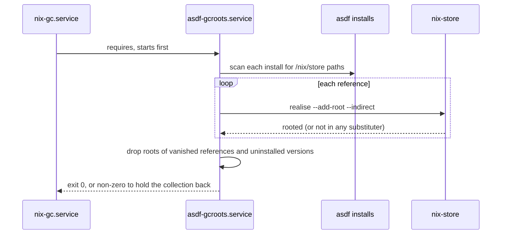

# asdf-gcroots

## Why

asdf compiles some tools (pythons in particular) from source against nix store
paths: glibc, openssl, zlib and so on. Nothing roots those paths, so
`nix-collect-garbage` deletes them and the installed tool stops working.
`asdf-gcroots` (`modules/apps/asdf/`) roots them, and re-fetches any that are
already gone, before every garbage collection.

## How

The script scans every file under `$ASDF_DATA_DIR/installs/<plugin>/<version>/`
for `/nix/store/<hash>-<name>` references: `grep -l` narrows to files that mention
the store at all (ELF files, `_sysconfigdata_*.py`, Makefiles), then only those are
scanned for the full paths. Each path is realised with `nix-store --realise`
(substituting a GC'd one back from the cache) and registered as an indirect GC root
in `$ASDF_GCROOTS_DIR/<plugin>-<version>/`
(default `~/.local/state/asdf-gcroots`).

## Systemd unit

`modules/apps/asdf/asdf-gcroots.nix` defines the oneshot `asdf-gcroots.service`,
running as the primary user. It exists only on hosts with
`programs.asdf.plugins` set (the `vm` host has none). It has no `wantedBy`, so
boot and switches never wait on a network-dependent unit: `nix-gc.service`
requires it and runs it first, and a failure stops the collection that would break
the tools. The first run after install can be started by hand
(`sudo systemctl start asdf-gcroots`).

## Behaviour

- `asdf-gcroots --list` prints `<plugin> <version> <store path>` and changes
  nothing.
- Safe by default: a missing or empty `installs/` directory keeps every root. An
  install with read errors keeps its existing roots. Only when every install fails
  to read does it exit 1.
- Store paths that cannot be realised only warn, with the fix
  (`asdf uninstall` then `asdf install` of that version).
- Debugging: `systemctl status asdf-gcroots nix-gc`, `journalctl -u asdf-gcroots`.

The script's PATH is exactly `nix` plus `_runtime-inputs.nix` (grep, findutils,
coreutils), shared with its flake check.
