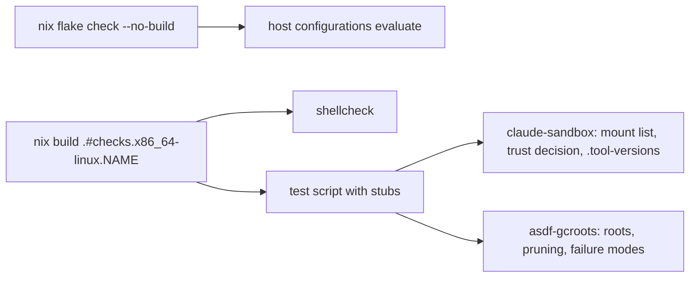

# Building and checking

```sh
nix flake check --no-build              # evaluate every module, host and check
nix build .#nixosConfigurations.<host>.config.system.build.toplevel --dry-run
./nixos-rebuild.sh <host>                # sudo nixos-rebuild switch --flake .#<host>
```

`<host>` is `framework-work`, `framework-personal` or `vm`. Only `vm` is meant to
be rebuilt from a dev machine: the framework hosts need real hardware, and disko
partitions real disks, so do not switch them without confirming the target device.

## Script checks

The sandbox and asdf-gcroots scripts each have a flake check (shellcheck plus a
test script) and can be run directly:

```sh
bash modules/apps/claude/claude-sandbox-test.sh   # launcher with a stubbed podman: asserts the mount list
bash modules/apps/asdf/asdf-gcroots-test.sh       # GC roots, run with a minimal PATH
shellcheck -s bash modules/apps/claude/*.sh modules/apps/asdf/*.sh
nix build .#checks.x86_64-linux.claude-sandbox .#checks.x86_64-linux.asdf-gcroots
```



`nix flake check --no-build` only evaluates, so the script checks need an explicit
build (or the direct `bash` run) to execute. Pinned values that `flake.lock` does
not cover are listed in [`UPDATES.md`](../UPDATES.md) with how to bump them.
