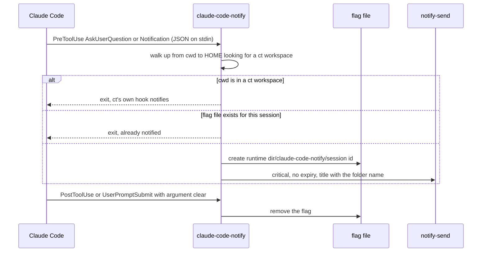

# Claude Code notifications

`modules/apps/claude/claude-code.nix` generates Claude Code's `settings.json`
(shared by the host and claude-sandbox). Its hooks run one script,
`claude-code-notify`, which sends a desktop notification through `notify-send`
when a session needs the user. The notification is critical and has no expiry,
so it stays until dismissed. Claude Code's own terminal notifications are off
(`preferredNotifChannel = "notifications_disabled"`): the hooks are the only
notifier. There is no ping when a turn ends.

## Hooks

| Event | Matcher | Script argument |
| --- | --- | --- |
| `Notification` | `permission_prompt`, `elicitation_dialog`, `idle_prompt` | none (notify) |
| `PreToolUse` | `AskUserQuestion` | none (notify) |
| `PostToolUse` | any tool | `clear` |
| `UserPromptSubmit` | any | `clear` |

## Flow

- A ct workspace is a directory with `CLAUDE.md` and a `workspace.json` that has
  an `id`, at or above the cwd and below `$HOME`. Those sessions are left to
  ct's hook, which also knows not to ping while the ticket's agents run.
- The message is the first question of an `AskUserQuestion`, else the
  notification's `message`, else `needs you`.
- One notification per session until the user answers: the flag lives in
  `$XDG_RUNTIME_DIR/claude-code-notify/<session id>` (`/tmp` when unset) and is
  cleared by any prompt submit or any tool that ran afterwards (for example
  after an approved permission prompt).
- The script is baked as a `/nix/store` path, so it works unchanged inside
  claude-sandbox.
