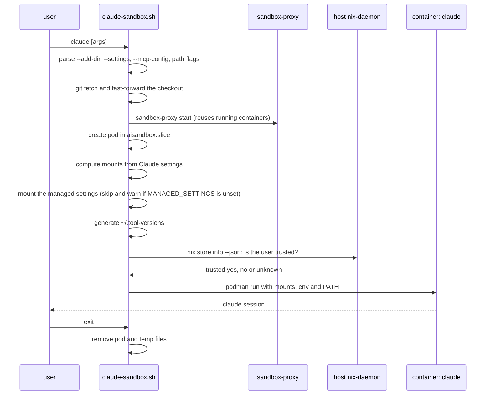
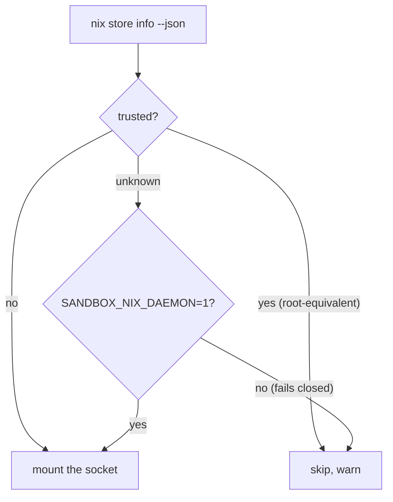
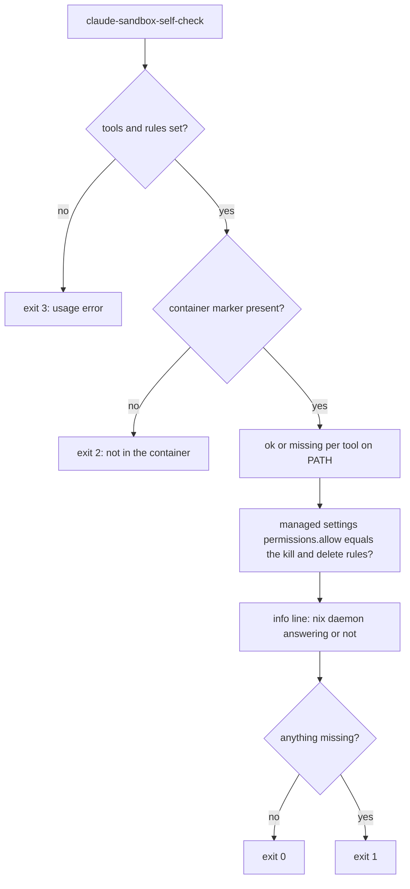

# claude-sandbox

`claude` (and its alias `claude-sandbox`) runs Claude Code inside a privileged,
rootless podman container scoped to the current directory. `claude-open` runs the
same pinned claude-code unsandboxed. All three first fast-forward a git checkout
in the current directory to its upstream (`claude-git-update.sh`); diverged
branches or local changes are reported and left alone.

The module is `modules/apps/claude/claude-sandbox.nix` (a home-manager module,
`programs.claudeSandbox.*`); the launcher is `claude-sandbox.sh`. `claude-sandbox
--help` documents every setting. The same launcher runs kiro-cli with
`SANDBOX_AGENT=kiro` ([kiro-sandbox](./kiro-sandbox.md)); the Claude-only parts
(argument parsing, settings and deny rules, managed settings, `~/.claude`, the
herdr usage relay) are guarded by that variable.

## Launch

Each step is timestamped on stderr (`--quiet` keeps only warnings) and always
appended to `~/.local/state/claude-sandbox.log` (trimmed past 5 MiB), so a stuck
launch shows where it is. Everything is pinned: claude-code is
`programs.claudeSandbox.package` from the flake's nixpkgs, so a launch evaluates
and downloads nothing.

## Pods

Each session runs in its own pod named after the git repo (origin's URL, else
the first remote) plus the checkout folder, e.g.
`claude-sandbox-billing-service-db4005a08` (just the folder when it matches the
repo or there is no remote), with `-2`, `-3`... for concurrent sessions in one
checkout. Pods carry `claude-sandbox.{repo,project,role}` labels:
`podman ps --filter label=claude-sandbox.repo=<repo>`.

- Pods of sessions that died without cleanup (killed, terminal closed, reboot)
  are removed once their agent container is gone and they are over 10 minutes
  old (a new pod has no agent container until the launch gets that far).
- Pod and containers go in `aisandbox.slice` (see
  [architecture](./architecture.md#resource-limits-aisandboxslice)). If the pod
  can't be placed there, the launch warns and runs without limits; any other
  pod-create error (a port conflict) aborts.
- `--init` puts catatonit at PID 1: it reaps the orphans claude's tools leave
  (git helpers otherwise pile up as zombies until the pids limit) and gives stdio
  MCP and language servers a real parent.
- The launch logs before its first podman call (the orphan sweep): podman calls
  hang while another podman process holds the storage lock, so a stuck podman
  shows in the log there first.

## Settings

The sandbox's own settings are environment variables, the same `SANDBOX_*` for
every agent (claude-sandbox and [kiro-sandbox](./kiro-sandbox.md)); the old
`CLAUDE_SANDBOX_*` / `KIRO_SANDBOX_*` names are no longer read and get a
warning. Lists given in the environment add to the configured ones.

| Variable | Effect |
|---|---|
| `SANDBOX_PORTS=3000,5173` | publish these ports on the same host ports, on 127.0.0.1 unless an IPv4 address is given (otherwise the port is open to the whole network) |
| `SANDBOX_NAME=<label>` | pod `<agent>-sandbox-<label>` instead of `<repo>-<folder>` |
| `SANDBOX_QUIET=1` | only warnings while launching |
| `SANDBOX_PASS_ENV="A_* B"` | more host variables to pass in (name globs), added to `programs.<agent>Sandbox.passEnv` |
| `SANDBOX_ADD_DIRS=/a:~/b` | more read-write directories; mounts only, the agent isn't told (tix sets it for the vault's sessions) |
| `SANDBOX_RO_PATHS=/a:~/b` | more read-only paths, added to `programs.<agent>Sandbox.readOnlyPaths` (tix adds the model cache) |
| `SANDBOX_NIX_DAEMON=1` | mount the nix-daemon socket when its trust can't be told |
| `SANDBOX_TRUST_ALL=0` | kiro chats ask before running tools (claude: no effect) |
| `SANDBOX_GIT_AUTOSIGN=0` | commits aren't signed by default; an explicit `git commit -S` still signs (tix sets it) |

The path lists are colon-separated and only `~` and `$HOME` are expanded (not
`~user`); missing read-only paths are skipped. A `readOnlyPaths` entry containing
`:` fails evaluation rather than being split at launch. `SANDBOX_PASS_ENV` is
space-separated; `TERM` and `COLORTERM` are always passed so Claude keeps its
palette.

## Mounts

What the session can touch follows Claude's own settings, not sandbox flags:

- read-write: the working directory, every `--add-dir` directory (also
  `permissions.additionalDirectories` from user, project and `--settings`), and
  every `SANDBOX_ADD_DIRS` directory (mounted only: Claude isn't given those);
- read-only: paths of `Edit(...)` / `Write(...)` deny rules that lie inside a
  read-write directory (the most specific path wins), files named by
  `--settings`, `--mcp-config`, `--plugin-dir` and `--*system-prompt-file`, and
  `programs.claudeSandbox.readOnlyPaths` plus `SANDBOX_RO_PATHS` (these even
  inside a read-write directory). A deny rule outside every read-write directory
  stays a permission rule only: mounting it would expose the path;
- rule paths are made absolute as Claude reads them (`//abs`, `~/home`, `/x`
  relative to the settings file's directory, anything else relative to the
  project); `dir/**` and `dir/*` mean `dir`;
- every path is mounted once, however many times it is given (`--add-dir`,
  `SANDBOX_ADD_DIRS`, settings); read-only wins: a path given both ways is
  read-only (the project too), and a read-only path around a read-write
  directory leaves that more specific directory writable;
- with an agent profile (`AGENT=<profile>`, [agents](./agents.md)) the
  profile's home takes `~/.claude`'s place, as `CLAUDE_CONFIG_DIR`;
- every folder counts as trusted (`CLAUDE_CODE_SANDBOXED=1`, Claude's own
  switch, set only in the container and never saved to `.claude.json`), so
  sessions skip the "trust this folder?" dialog; `claude-open` still asks;
- a deny rule with a `*` component (`a/*/*/*`, one clone per match) also makes the
  directory before the first whole-component `*` read-only, so a session
  can't create files at the levels in between or write into a clone made after
  launch; existing matches are mounted read-only too (symlinks skipped). A
  wildcard inside a name (`.env*`) never makes the project read-only, and a rule
  with `**` inside the path is left to the permission rule alone;
- `/nix/store` read-only, `~/.claude` read-write (its settings, filtered as in
  [Kill and delete commands](#kill-and-delete-commands), skills and agents
  read-only), the asdf data dir read-only, any vault's `.obsidian/`
  read-only.

The host-side Claude config (settings with hooks, skills, agents, `CLAUDE.md`)
stays read-only on top of writable mounts because a session could otherwise
plant a hook that runs unsandboxed on the host. An Obsidian vault's `.obsidian/`
is read-only for the same reason: its community plugins run in Obsidian on the
host.

### Git directories under read-write mounts

Every clone found up to four levels below a read-write directory
(`<dir>/<provider>/<owner>/<repo>/.git`, symlinks not followed, read-only
mounts skipped, not below `$HOME` when that is the scan root) gets `.git/hooks`
(created first if missing) and `.git/config` read-only. So does a `.git` given
read-write on its own (a main clone's, so the session can add worktrees). A worktree's
`.git` file is read-only, and so are the `commondir` and `gitdir` files of
existing worktrees (`.git/worktrees/` stays writable, so `git worktree add`
works). A main clone whose `.git` has a `commondir` file is redirected already:
the launcher warns and mounts its whole `.git` read-only. Without this a session
could repoint git at a config of its own and run code on the host the next time
git runs there. A clone made during the session is covered from the next launch.

In a protected clone `git branch -d` warns "could not write config file"
(the branch's config section can't be removed) but still deletes the ref;
ticket tooling uses `git update-ref -d` after a merge check. The protection
does not cover other config keys (filters, `sshCommand`, credential helpers)
or the user's own git in a clone made during the session; tix's host git turns
off hooks, fsmonitor and external diff and checks pointer files.

## nix-daemon socket and trust

`/nix/var/nix/daemon-socket` is mounted with `NIX_REMOTE=daemon`, so `nix eval`
and `nix flake check --no-build` work inside the sandbox. The trade-off: anything
in the sandbox can talk to the daemon as the invoking user and ask the host to
evaluate, fetch and build. `/nix/store` itself stays read-only.

That is only acceptable for an untrusted nix user. The launcher asks the daemon
(`nix store info --json`, field `trusted`) and decides:

A user in `nix.settings.trusted-users` never gets the socket: a trusted client
can set `sandbox=false`, add sandbox paths and import unsigned paths, which is
root on the host. The question is asked with the launcher's own nix. The
socket directory can be overridden only for the test (`SANDBOX_TEST=1`), since
it is mounted read-write. A client newer than the daemon is fine; if it ever
fails on the protocol after a flake update, pin it to `osConfig.nix.package`.

## `.tool-versions` fallback

asdf shims read `$HOME/.tool-versions` when no nearer file sets a tool, so
`python3`, `go` and `gofmt` would fail in a directory without one. The launcher
mounts a generated `~/.tool-versions` read-only: the host's own lines unchanged,
plus the newest installed version of every asdf plugin the host file does not
name (numeric `sort -V`; names like `3.14-dev` only count when no numeric one
exists). A `.tool-versions` nearer the working directory wins. If `$HOME` itself
is mounted, no file is generated.

## Dev tools and PATH

Inside the container `PATH` is, in order: asdf shims, asdf-vm, the nested podman
toolchain, the dev-tools environment, claude-code, then the image's `/usr/bin`.
The dev tools (`devToolsEnv` in the module) are built from the host's nixpkgs and
reached through the read-only store mount: git, git-lfs (its filters and
`lfs.sshtransfer=never` set through `GIT_CONFIG_*`, since `~/.gitconfig` is the
host's), coreutils and friends, ripgrep,
fd, jq, yq, archive tools, process and network tools, make, shellcheck,
Jujutsu (`jj`, for tidying unpushed history in a scratch clone), the `nix` client
and `programs.claudeSandbox.extraPackages`. The slim Debian image has little
beyond coreutils, grep and sed, and these come before its `/usr/bin`, shadowing
its copies, so the image needs nothing preinstalled. The nested podman toolchain
(also from the host's nixpkgs; conmon and crun are found on PATH at runtime)
lets the session run containers of its own. Its storage (`/var/lib/containers`)
and `podman build`'s temp dir (`/var/tmp`) are anonymous volumes, since an
overlay upperdir can't sit on the container's own overlayfs root (the build
fails with `overlay: ... userxattr`). `openssh` is there for `ssh-keygen`
only (no sshd, no ssh config).

Browser and media tools (`pw-node`, playwright, ffmpeg/ffprobe,
asciinema/agg, tmux) are there for verification evidence and work summaries.
The debian-slim image has no browser libraries or fonts, so Chromium (nixpkgs
pins it to the Playwright driver's version), fonts and ffmpeg come from the store.
Each wrapper sets its environment for itself only, so a repo's own
Playwright, node or browsers are untouched; tmux drives interactive CLIs and
TUIs for tix's verify drivers.

## Git: pushes and signing

[git-ssh-broker](./git-ssh-broker.md) runs on the host per session with two
sockets mounted in. Neither a host SSH key nor the host agent is ever reachable.

- The git socket carries git's transport commands to GitHub and Bitbucket
  through the host's ssh. It refuses branch/tag deletes, tag moves and force
  pushes, except rewriting a rewritable branch that drops only your commits
  (`GIT_SSH_BROKER_REWRITABLE_BRANCHES` / `_IDENTITY_EMAILS`, colon-separated,
  since neither ref names nor emails contain a colon).
- The agent socket (`SSH_AUTH_SOCK`) signs git signatures only, with
  `SANDBOX_SIGNING_KEYS` (public halves mounted read-only), through the host's
  `SSH_AUTH_SOCK` or `GIT_SSH_BROKER_UPSTREAM_AGENT`. `~/.ssh/allowed_signers` is
  mounted read-only for verifying signatures.
- Commits get their author from the host's global git config (a `/nix/store`
  file with per-remote identity includes) and are signed through the broker's
  agent. Without keys or agent, signing is turned off and sessions still commit
  and push unsigned. The global excludes file is applied through
  `core.excludesFile`, since `~/.config` isn't mounted.

The Claude deny rules on pushes are not the lock; the broker is. `git push` is
denied on the host (`claude-open`), where it would use the full SSH agent, and
allowed in the container by the managed settings. The managed settings still
deny force pushes and branch deletes so Claude stops and asks the user to do it
on the host; a managed deny can't be lifted by any other settings file.
`git push --force-with-lease` is deliberately not denied (the ticket autopilot
pushes its rebased branch that way, and the broker decides), and a `:branch`
refspec delete has no rule (`:*` is the rules' prefix syntax); the broker
refuses it all the same.

## Kill and delete commands

Claude Code's permission layer (not the OS) stops `kill`, `pkill` and `killall`
by default, and the user settings deny `rm -rf`. The launcher mounts a
Nix-generated managed-settings file read-only at
`/etc/claude-code/managed-settings.json` that allows, in the container only:

- `Bash(kill:*)`, `Bash(pkill:*)`, `Bash(killall:*)`
- `Bash(rm:*)`, `Bash(rm -rf:*)`, `Bash(rmdir:*)`, `Bash(unlink:*)`

A deny wins over an allow at any settings level, so the allow alone wouldn't
lift the user settings' `rm -rf` deny. The launcher therefore mounts a copy of
`~/.claude/settings.json` without the deny rules the managed settings allow
(read-only, over the original); every other rule stays. The host's settings are
unchanged, so `claude-open` still denies `rm -rf`. Project settings (e.g. a
ticket workspace's `git clean` deny) are not filtered.

If the Nix wrapper did not set `MANAGED_SETTINGS`, the launcher skips the mount
and warns on stderr, and mounts the user settings unfiltered; the session then
keeps Claude's default permission checks for those commands.

## Self-check

`claude-sandbox-self-check` (on the sandbox PATH, in `devToolsEnv`) reports what
the session has, one line per check, so a sandbox fix can be confirmed after a
rebuild in a new session without a live repro.

- Lines are `ok:`, `missing:` or `info:`; the nix daemon is `info:` only.
- Tools: `git jj ssh-keygen kill pkill killall rg jq nix`, checked with
  `type -P` (external files only, so the bash builtin `kill` doesn't count) on
  the session's own PATH (the command has no `runtimeInputs`, so the checks are
  real).
- Settings: `/etc/claude-code/managed-settings.json` must be readable JSON whose
  `permissions.allow` is exactly the kill and delete rules (order ignored).
- The tool and rule lists are the Nix lists the image build uses
  (`expectedTools`, `sandboxAllowRules` in `claude-sandbox.nix`), so they can't drift;
  the script has no defaults for them.
- The wrapper exports every `SELF_CHECK_*` input (lists, container marker,
  settings path, nix socket, store paths of `jq` and `timeout`), so an inherited
  value can't fake a result. They are test-only knobs, set by running the bare
  script.
- Test: `modules/apps/claude/claude-sandbox-self-check-test.sh`.

## Other pieces

- **MCP servers**: the sandbox joins [sandbox-proxy](./sandbox-proxy.md)'s
  `sandbox-registry` network once `sandbox-proxy host-login` is configured, and
  `sandbox-mcp` once servers were added; the servers are registered with claude
  without their tokens. `programs.claudeSandbox.extraMcpServers` (stdio, none by
  default) and the proxy's servers go into one `--mcp-config` file (a store path),
  which claude merges with any `--mcp-config` of the caller.
- **notifications**: xdg-dbus-proxy sits between the container and the session
  bus and allows only `org.freedesktop.Notifications`; only the filtered socket
  is mounted.
- **herdr usage**: herdr's socket would let the sandbox drive every pane, so the
  status line writes its fields to a file in a host-mounted dir
  (`SANDBOX_HERDR_DIR`) and the launcher reports them, cut to 64 characters,
  control characters removed, symlinks ignored ([terminal-tools](./terminal-tools.md)).
- **review-broker**: in a tix ticket workspace (a `workspace.json` in the
  project) a [review-broker](./architecture.md#review-broker) socket is mounted
  as `TIX_REVIEW_BROKER_SOCKET`; kiro's login never enters this sandbox.
- **language servers**: `programs.claudeSandbox.lspServers` (by default gopls,
  typescript-language-server, ruby-lsp, terraform-ls, bash-language-server,
  yaml-language-server, nixd, basedpyright and dart; none for SQL, HAML or ERB) become a
  Claude Code plugin (`.lsp.json`) that both `claude` and `claude-open` load
  with `--plugin-dir`; `ENABLE_LSP_TOOL=1` (claude-code.nix) turns on the LSP
  tool, and the `lsp` skill tells Claude when to use it. Servers start on
  demand for the files they claim. gopls takes `go` from the session's PATH
  (asdf), typescript-language-server prefers a project's own typescript,
  ruby-lsp runs on its own Ruby and writes a self-ignored `.ruby-lsp/`, and dart
  needs `flutter pub get` to have run. There is no SQL server because sqls needs
  a configured database.
- **resource limits**: pod and containers run under `aisandbox.slice`.
- **pins**: the image (by digest) and claude-code (flake nixpkgs) are pinned; see
  [`UPDATES.md`](../UPDATES.md).
