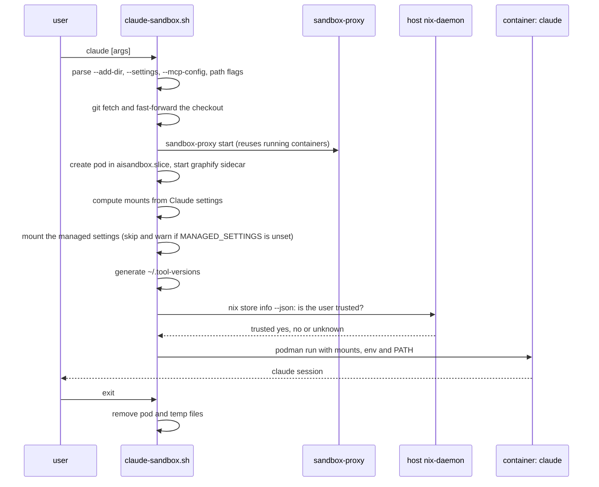
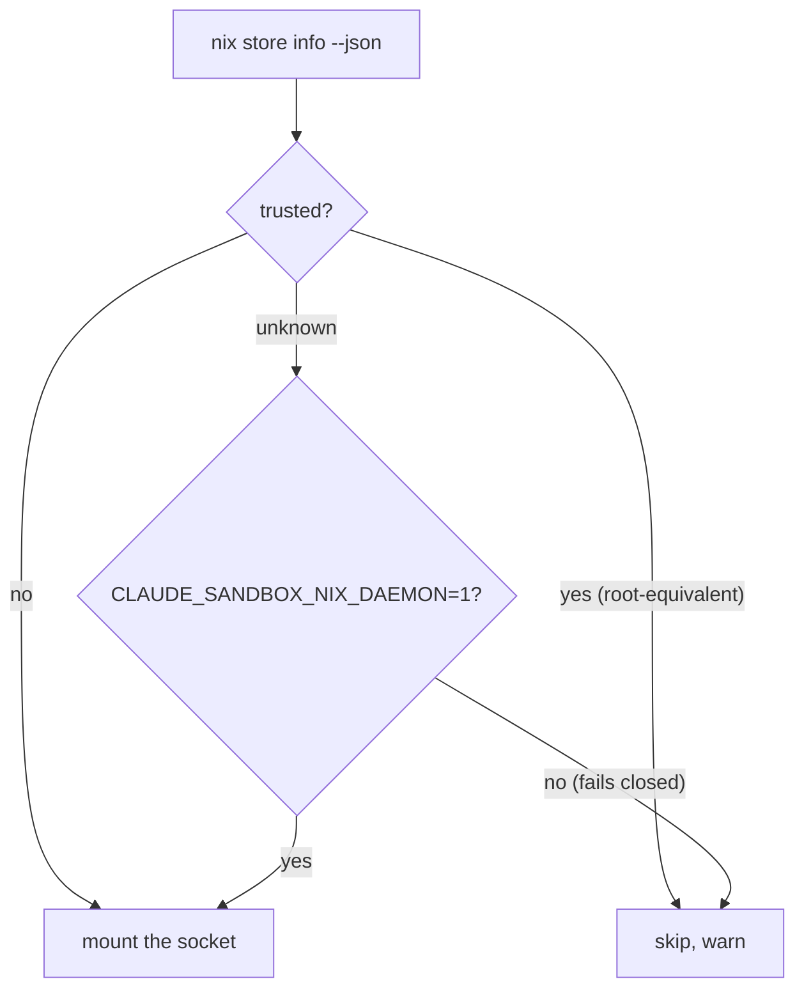
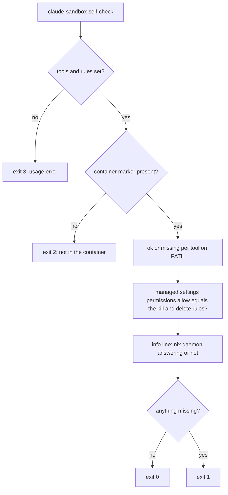

# claude-sandbox

`claude` (and its alias `claude-sandbox`) runs Claude Code inside a privileged,
rootless podman container scoped to the current directory. `claude-open` runs the
same pinned claude-code unsandboxed. All three first fast-forward a git checkout
in the current directory to its upstream (`claude-git-update.sh`); diverged
branches or local changes are reported and left alone.

The module is `modules/apps/claude/claude-sandbox.nix` (a home-manager module,
`programs.claudeSandbox.*`); the launcher is `claude-sandbox.sh`. `claude-sandbox
--help` documents every setting.

## Launch

Each step is timestamped on stderr and appended to
`~/.local/state/claude-sandbox.log`, so a stuck launch shows where it is.

## Mounts

What the session can touch follows Claude's own settings, not sandbox flags:

- read-write: the working directory and every `--add-dir` directory (also
  `permissions.additionalDirectories` from user, project and `--settings`);
- read-only: paths of `Edit(...)` / `Write(...)` deny rules that lie inside a
  read-write directory (the most specific path wins), files named by
  `--settings`, `--mcp-config`, `--plugin-dir` and `--*system-prompt-file`, and
  `programs.claudeSandbox.readOnlyPaths`;
- a deny rule with a `*` component (`a/*/*/*`, one clone per match) also makes the
  directory before the first whole-component `*` read-only, so a session
  can't create files at the levels in between or write into a clone made after
  launch; existing matches are mounted read-only too (symlinks skipped). A
  wildcard inside a name (`.env*`) never makes the project read-only, and a rule
  with `**` inside the path is left to the permission rule alone;
- `/nix/store` read-only, `~/.claude` read-write (its settings, filtered as in
  [Kill and delete commands](#kill-and-delete-commands), skills and agents
  read-only), the asdf data dir read-only, any vault's `.obsidian/`
  read-only.

### Git directories under read-write mounts

Every clone found up to four levels below a read-write directory
(`<dir>/<provider>/<owner>/<repo>/.git`, symlinks not followed, read-only
mounts skipped) gets `.git/hooks` and `.git/config` read-only. A worktree's
`.git` file is read-only, and so are the `commondir` and `gitdir` files of
existing worktrees (`.git/worktrees/` stays writable, so `git worktree add`
works). A main clone whose `.git` has a `commondir` file is redirected already:
the launcher warns and mounts its whole `.git` read-only. Without this a session
could repoint git at a config of its own and run code on the host the next time
git runs there. A clone made during the session is covered from the next launch.

In a protected clone `git branch -d` warns "could not write config file"
(the branch's config section can't be removed) but still deletes the ref;
ticket tooling uses `git update-ref -d` after a merge check. The protection
does not cover other config keys (filters, `sshCommand`, credential helpers).

## nix-daemon socket and trust

`/nix/var/nix/daemon-socket` is mounted with `NIX_REMOTE=daemon`, so `nix eval`
and `nix flake check --no-build` work inside the sandbox. The trade-off: anything
in the sandbox can talk to the daemon as the invoking user and ask the host to
evaluate, fetch and build. `/nix/store` itself stays read-only.

That is only acceptable for an untrusted nix user. The launcher asks the daemon
(`nix store info --json`, field `trusted`) and decides:

A user in `nix.settings.trusted-users` never gets the socket.

## `.tool-versions` fallback

asdf shims read `$HOME/.tool-versions` when no nearer file sets a tool, so
`python3`, `go` and `gofmt` would fail in a directory without one. The launcher
mounts a generated `~/.tool-versions` read-only: the host's own lines unchanged,
plus the newest installed version of every asdf plugin the host file does not
name (numeric `sort -V`; names like `3.14-dev` only count when no numeric one
exists). A `.tool-versions` nearer the working directory wins. If `$HOME` itself
is mounted, no file is generated.

## Dev tools and PATH

Inside the container `PATH` is, in order: asdf shims, asdf-vm, the nested podman
toolchain, the dev-tools environment, claude-code, then the image's `/usr/bin`.
The dev tools (`devToolsEnv` in the module) are built from the host's nixpkgs and
reached through the read-only store mount: git, coreutils and friends, ripgrep,
fd, jq, yq, archive tools, process and network tools, make, shellcheck,
Jujutsu (`jj`, for tidying unpushed history in a scratch clone), the `nix` client
and `programs.claudeSandbox.extraPackages`. The nested podman toolchain lets the
session run containers of its own. `openssh` is there for `ssh-keygen` only (no
sshd, no ssh config).

## Kill and delete commands

Claude Code's permission layer (not the OS) stops `kill`, `pkill` and `killall`
by default, and the user settings deny `rm -rf`. The launcher mounts a
Nix-generated managed-settings file read-only at
`/etc/claude-code/managed-settings.json` that allows, in the container only:

- `Bash(kill:*)`, `Bash(pkill:*)`, `Bash(killall:*)`
- `Bash(rm:*)`, `Bash(rm -rf:*)`, `Bash(rmdir:*)`, `Bash(unlink:*)`

A deny wins over an allow at any settings level, so the allow alone wouldn't
lift the user settings' `rm -rf` deny. The launcher therefore mounts a copy of
`~/.claude/settings.json` without the deny rules the managed settings allow
(read-only, over the original); every other rule stays. The host's settings are
unchanged, so `claude-open` still denies `rm -rf`. Project settings (e.g. a
ticket workspace's `git clean` deny) are not filtered.

If the Nix wrapper did not set `MANAGED_SETTINGS`, the launcher skips the mount
and warns on stderr, and mounts the user settings unfiltered; the session then
keeps Claude's default permission checks for those commands.

## Self-check

`claude-sandbox-self-check` (on the sandbox PATH, in `devToolsEnv`) reports what
the session has, one line per check, so a sandbox fix can be confirmed after a
rebuild in a new session without a live repro.

- Lines are `ok:`, `missing:` or `info:`; the nix daemon is `info:` only.
- Tools: `git jj ssh-keygen kill pkill killall rg jq nix`, checked with
  `type -P` (external files only, so the bash builtin `kill` doesn't count) on
  the session's own PATH.
- Settings: `/etc/claude-code/managed-settings.json` must be readable JSON whose
  `permissions.allow` is exactly the kill and delete rules (order ignored).
- The tool and rule lists are the Nix lists the image build uses
  (`expectedTools`, `sandboxAllowRules` in `claude-sandbox.nix`), so they can't drift;
  the script has no defaults for them.
- The wrapper exports every `SELF_CHECK_*` input (lists, container marker,
  settings path, nix socket, store paths of `jq` and `timeout`), so an inherited
  value can't fake a result. They are test-only knobs, set by running the bare
  script.
- Test: `modules/apps/claude/claude-sandbox-self-check-test.sh`.

## Other pieces

- **graphify sidecar** (`claude-sandbox-graphify-sidecar.sh`): builds a code
  knowledge graph of the project and every `--add-dir` codebase and serves it as
  the `graphify` MCP server on the pod's localhost. Skip it with
  `CLAUDE_SANDBOX_NO_GRAPHIFY=1`.
- **extra MCP servers**: `programs.claudeSandbox.extraMcpServers` (by default
  `fff`) are merged with the proxy's and graphify's.
- **resource limits**: pod and containers run under `aisandbox.slice`.
- **pins**: the images (by digest), claude-code (flake nixpkgs) and graphify (hashed
  pip lock) are pinned; see [`UPDATES.md`](../UPDATES.md).
