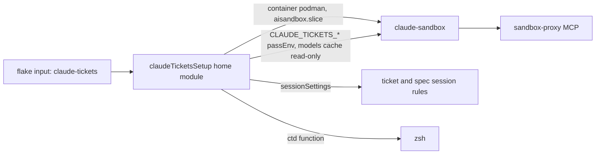
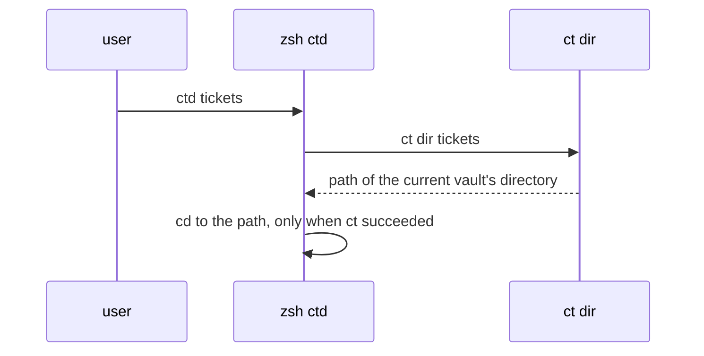

# claude-tickets wiring

`modules/apps/claude-tickets.nix` provides `flake.homeModules.claudeTicketsSetup`,
which connects the claude-tickets flake input (the ticket workflow and Obsidian
vaults, its own repository) to this machine.

## What it sets

- The sandbox runs in podman under `aisandbox.slice`; `CLAUDE_TICKETS_*`
  variables are passed into it and the model cache under
  `$XDG_CACHE_HOME/claude-tickets/models` is mounted read-only.
- Ticket and spec sessions commit on their branches, signed through
  git-ssh-broker's agent, and push through the broker, which refuses force pushes
  and branch or tag deletes.
- `sessionSettings.permissions.deny` adds the rules those sessions never get
  (`git reset --hard`, `git branch -D`, ...), on top of claude-tickets' own
  (the graph cache read-only; spec sessions also stay out of the repos). The
  workspace settings file is read-only in the sandbox, so a session can't relax
  them.
- Exception to that deny list: the lead adds and removes git worktrees, one per
  task under the ticket workspace's `tasks/`, and removes each once its branch
  is merged, deleting the branch ref with `git update-ref -d` after checking
  it is merged (`git branch -d` would write the main clone's read-only config;
  `-D` stays denied).
- `sessionSettings.autoCompactWindow = 260000`: ticket sessions compact just
  past ct's last context warning (250k tokens). The PO checkpoints its board and
  relay at the warnings, and ct's SessionStart hook resumes it afterwards.
- Rovo tools that consume paid credits are denied.
- `CLAUDE_SANDBOX_*` set in the shell that runs `ct` reach that one session,
  because the session runs in the foreground of that shell and inherits its
  environment: `CLAUDE_SANDBOX_PORTS=3000 ct start PROJ-12`.
- `ctd work|tickets|repos` is a zsh function: it runs `ct dir <arg>` and `cd`s
  to the printed directory (a command can't change the shell's directory).

## Flow: opening a directory

