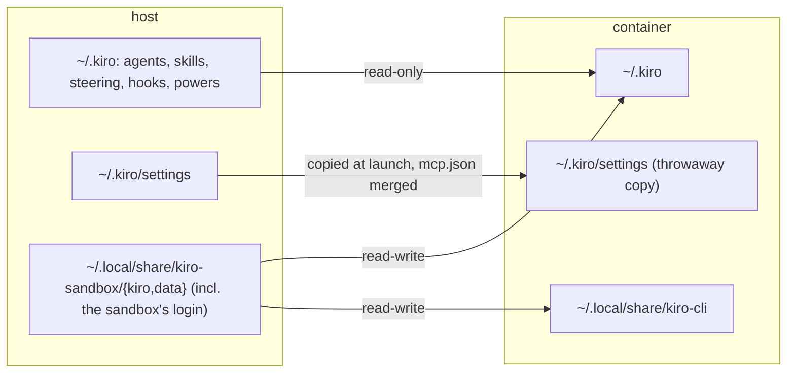

# kiro-sandbox

`kiro` (and its alias `kiro-sandbox`) runs kiro-cli inside the same privileged,
rootless podman sandbox as [claude-sandbox](./claude-sandbox.md), scoped to the
current directory. `kiro-open` runs the pinned kiro-cli unsandboxed. All three
first fast-forward a git checkout in the current directory to its upstream.

The module is `modules/apps/kiro/kiro-sandbox.nix` (a home-manager module,
`programs.kiroSandbox.*`). It has no launcher of its own: it runs
`modules/apps/claude/claude-sandbox.sh` with `SANDBOX_AGENT=kiro`, reusing the
pieces `programs.claudeSandbox.shared` exposes (the script, its
agent-independent environment, the base dev tools, the git update).
`kiro-sandbox --help` documents every setting.

A kiro-cli installed outside Nix (the upstream installer's `~/.local/bin/kiro-cli`)
is not touched: it stays unsandboxed and self-updating.

## Shared with claude-sandbox

Everything that doesn't depend on the agent works as in
[claude-sandbox](./claude-sandbox.md): the pod in `aisandbox.slice`, the image
pinned by digest, the `.git/config` and `.git/hooks` protection of every clone
under a read-write directory, `/nix/store` and the asdf data dir read-only, the
nix-daemon socket for untrusted nix users only, the generated `~/.tool-versions`,
git over SSH and commit signing through git-ssh-broker, sandbox-proxy's
registries and MCP servers, the DBus notification proxy, the CA bundle and
read-only `.obsidian/` folders. Pods are `kiro-sandbox-<repo>-<folder>`, labelled
`kiro-sandbox.{repo,project,role}`; the launch log is
`~/.local/state/kiro-sandbox.log`.

## What differs

- **Own state.** The host's `~/.kiro` is never writable in the sandbox. kiro keeps
  workspace trust and "always allow" rules (`~/.kiro/workspace-roots/`), agents
  with hooks, MCP servers and settings there, and `kiro-open` on the host would act
  on them. The sandbox gets its own `~/.kiro` and kiro-cli data dir in
  `~/.local/share/kiro-sandbox/{kiro,data}`, kept across sessions. Sessions,
  history, trust and rules given in the sandbox stay in the sandbox.
- **Own runtimes.** kiro-cli extracts the runtimes it executes (bun, node, the
  agent server under `kas/`) into its data dir. With a separate data dir, a
  session can't replace what the host runs.
- **Login.** The sandbox has its own login, in its data dir's `data.sqlite3`; the
  host's is never copied in or read. An interactive chat (`kiro`, `kiro chat ...`)
  first runs `kiro-cli whoami` in the container and, when the sandbox isn't
  logged in (or the token can't be refreshed), `kiro-cli login --use-device-flow`:
  open the URL it prints in the host's browser and enter the code, and the chat
  starts once the login succeeds. The login is kept for later sessions. Other
  subcommands and headless runs (no terminal) don't log in by themselves.
- **Host config, read-only.** `~/.kiro/{agents,skills,steering,hooks,powers}` are
  mounted read-only when they exist. `~/.kiro/settings` is a throwaway copy, so
  settings changed in a session are dropped at exit. Its `mcp.json` is the host's
  servers plus sandbox-proxy's and `programs.kiroSandbox.extraMcpServers` (the
  later ones win on a name clash).
- **Read-write directories.** kiro has no `--add-dir` and no path deny rules. The
  read-write directories are the current directory plus `SANDBOX_ADD_DIRS`
  (colon-separated). Read-only paths are `programs.kiroSandbox.readOnlyPaths`
  plus `SANDBOX_RO_PATHS`.
- **Settings variables.** The settings are the same `SANDBOX_*` as
  claude-sandbox's (see [claude-sandbox](./claude-sandbox.md#settings)); the
  old `KIRO_SANDBOX_*` names are no longer read and get a warning.
- **Accounts.** With an agent profile (`AGENT=<profile>`, [agents](./agents.md))
  the profile's home replaces `~/.kiro` as the source of the read-only config
  and settings, and the sandbox's own state (and login) is
  `<home>/.sandbox/{kiro,data}` (herdr's usage rows read it there); the
  login `kiro-open` keeps in `<home>/.data/kiro-cli` isn't used.
- **Every tool trusted.** A chat (`kiro`, or `kiro chat ...`) runs
  `kiro-cli chat --trust-all-tools ...`, the counterpart of claude-sandbox's
  managed allow rules: the container is the boundary, and git-ssh-broker still
  refuses force pushes and branch/tag deletes. The settings copy sets
  `chat.disableTrustAllConfirmation`, so kiro doesn't ask to confirm; the host's
  settings are untouched and `kiro-open` keeps kiro's prompts. Other
  subcommands (`login`, `agent`, `settings`, ...) are left alone, a trust flag
  of your own (`-a`, `--trust-all-tools`, `--trust-tools=...`) is used as given,
  and `SANDBOX_TRUST_ALL=0` turns it off for a session.
- **No Claude extras.** There are no managed settings, no Claude settings
  filtering, no `claude-sandbox-self-check`. herdr's usage rows come from
  kiro's own session records instead of a status line (see
  [terminal-tools](./terminal-tools.md)).
- **Language servers.** `programs.kiroSandbox.lspPackages` are put on PATH for
  kiro's code tool (`/code init`). By default these are the servers its built-in
  configs start (gopls, typescript-language-server, pyright, solargraph), plus
  ruby-lsp, terraform-ls, bash-language-server, yaml-language-server and nixd for
  a workspace `lsp.json` to name.

## Residual risk

A project's own `.kiro/` (hooks, agents, `settings/mcp.json`, `settings/lsp.json`)
is part of the read-write project, as `.claude/` is for claude-sandbox. A session
could write a hook or server command there that `kiro-open` would later run on the
host in a workspace the host already trusts. Review `.kiro/` changes before running
`kiro-open` in a directory a sandboxed session has worked in.

## Packages

- In the container: `programs.kiroSandbox.package` (default
  `pkgs.kiro-cli-unwrapped`). The Debian image runs the generic-glibc runtimes that
  kiro-cli extracts as they are.
- For `kiro-open`: `programs.kiroSandbox.openPackage` (default `pkgs.kiro-cli`,
  nixpkgs' FHS-wrapped build).

Both come from the flake's nixpkgs; see [`UPDATES.md`](../UPDATES.md).

## Tests

The kiro cases are in `modules/apps/claude/claude-sandbox-test.sh` (part of the
`claude-sandbox` flake check). They cover the state and settings mounts, the
merged `mcp.json`, logging in before an interactive chat (and not otherwise),
`SANDBOX_ADD_DIRS` and
`SANDBOX_RO_PATHS`, trusting all tools in chats (and
`SANDBOX_TRUST_ALL=0`), herdr's usage rows, and `--help`.
