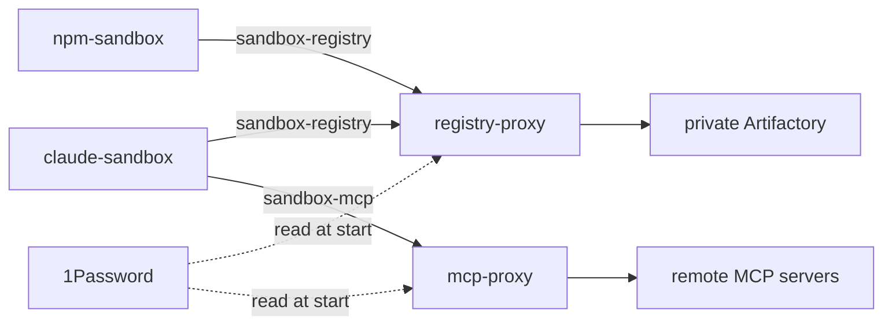
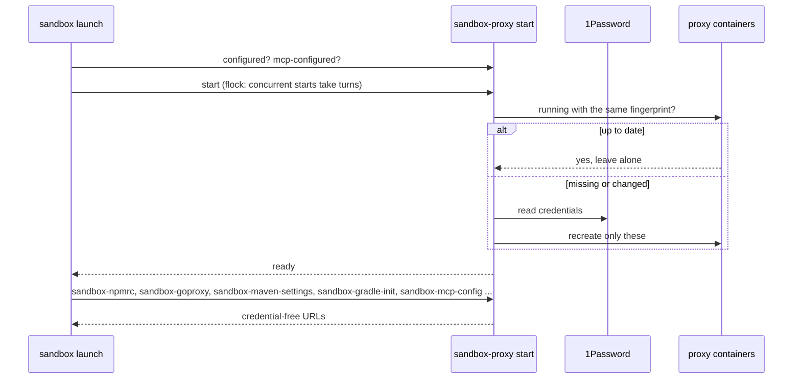

# sandbox-proxy

`sandbox-proxy` (`modules/apps/sandbox-proxy/`) is the credential broker for the
sandboxes. Real credentials are read from 1Password on the host and only ever
handed to proxy containers, which inject them into upstream requests. Sandboxes
get credential-free URLs on host-local podman networks.

| Service | Network | Joined by | Containers |
| --- | --- | --- | --- |
| package registries | `sandbox-registry` | claude-sandbox, kiro-sandbox, npm-sandbox | registry-proxy (caddy), registry-cache (docker pull-through), npm-proxy (Verdaccio) |
| MCP servers | `sandbox-mcp` | claude-sandbox and kiro-sandbox only | mcp-proxy (caddy), mcp-guard |

npm-sandbox runs untrusted install scripts, so it never joins `sandbox-mcp`: a
proxy that acts as you against Jira or Bitbucket must not be reachable from it.

## Starting

Every container carries a fingerprint label of what it was built from except the
secrets (the script, the non-secret config, the Caddyfile template, the guard and
its policies, the pinned images, so an image bump recreates it). All sandboxes share
one set of containers, so `start` leaves matching ones running: a new session never
cuts off another's in-flight requests, and 1Password is only read when something is
recreated. Sandboxes launched together (`tix start A B C`) take turns through a
flock on `start.lock`, waiting at most 2 minutes. `sandbox-proxy restart
[registry|mcp]` recreates them, for example after rotating a credential.

Secrets are never written to disk: the generated Caddy and guard configs only
reference `{$MCP_AUTH_<NAME>}` placeholders, filled from environment variables
passed with `-e`. A server's credential is read at start, so a missing one fails
early. The generated config lives in the runtime dir, so reuse also requires it
to still exist.

## Registries

- The npm/docker vhost is the Artifactory hostname itself, and sandboxes
  `--add-host` that name to registry-proxy's fixed IP on the network's explicit
  subnet (`ensure_network` recreates a network with another subnet). So
  `package-lock.json` keeps the real private domains and needn't be regenerated
  after a session.
- Caddy serves that name with `tls internal`; sandboxes skip verification
  (`strict-ssl=false` in their `.npmrc`), since a real certificate chain isn't
  worth the fragility. Caddy strips the npm path prefix before Verdaccio.
- Docker registry v2 requests that miss the registry-cache pull-through mirror
  (404/5xx) fall through to Artifactory with credentials; `:7080` is the Go
  and Maven proxy, adding basic auth to every request.
- Maven gets plain HTTP to `:7080` rather than the `tls internal` vhost: the
  JVM trusts only its own `cacerts`, not the sandbox's CA bundle. With
  `host-login --maven-repo`, sandboxes get a read-only `~/.m2/settings.xml`
  (`sandbox-maven-settings`) mirroring every repository (`mirrorOf *`) to
  `http://registry-proxy:7080/artifactory/<repo>/`, so Maven Central and any
  repository a POM names resolve through Artifactory, and no credential is in
  the sandbox. `MVNW_REPOURL` points `./mvnw`'s own download there too.
- Gradle gets a read-only `~/.gradle/init.d/sandbox-proxy.gradle`
  (`sandbox-gradle-init`) that points only repositories on the Artifactory
  host at the same HTTP route (settings, plugin management and projects);
  public ones (Gradle plugin portal, services.gradle.org) stay direct, since
  Artifactory has no remote for them.
- The same files work inside `podman build`: nested containers resolve
  `registry-proxy`, so the build's `RUN` steps get them as `-v` mounts (the
  `java` skill has the command).
- The Artifactory host and npm/go/docker/maven paths are read back from the native
  config `host-login` wrote. Only `GOPROXY`'s first entry (ours) matters; later
  entries are the fallback chain `host-login` keeps.

## MCP guard

A token's scopes can't tell "open a pull request" from "merge it" (Rovo's write
scope covers both), so every MCP route goes through mcp-guard
(`modules/apps/sandbox-proxy/mcp-guard/`, a static Go binary on the caddy
image's root filesystem). It adds the server's credential and refuses gated
tool calls whose operation isn't in the server's `programs.sandboxProxy.mcpPolicies`
allowlist. It reads JSON-RPC bodies by exact key and refuses repeated keys and
encoded or unreadable bodies.

`mcpPolicies.atlassian`:

- allowed: opening and updating pull requests, working their review threads and
  tasks, attaching work-summary media to a Jira issue. Jira's primary tools
  (comments, transitions) aren't gated;
- refused: merge, decline, approve and request changes (the user's calls),
  `createBitbucketRepoCommit`/`Branch` (would bypass
  [git-ssh-broker](./git-ssh-broker.md)), `runBitbucketRepoPipeline` (custom
  pipelines can deploy), and every `executeDestructive`.

## Setup

- Registries: `sandbox-proxy host-login <host> --npm-repo <repo> --go-repo <repo>
  --docker-repo <repo> [--maven-repo <repo>]` (here `java-virtual`), with a 1Password item titled like the Artifactory host
  (username and password fields).
- MCP servers: `sandbox-proxy mcp add <name> --url <url> --op-item <item>
  [--auth basic|bearer]` stores the server (no secrets) in
  `~/.config/sandbox-proxy/mcp-servers.json`. The mcp-proxy serves
  `http://mcp-proxy:8080/<name>` and injects the `Authorization` header. The same
  routes are published on host loopback (`host-mcp-config`) for host tools that
  talk to the servers without a model (`tix sync`); any local process can use
  them with the credentials the proxy injects.
- The 1Password item holds `username` (basic auth only) and `password` (the
  token); the Artifactory credential is the item titled exactly the hostname.
- Anything inside a claude-sandbox or kiro-sandbox (agent, install script,
  nested container) can call the MCP proxy as you, so each token's scopes are
  the real limit: keep them read-only, except ticket creation if wanted.
- The npm cache keeps every tarball fetched; `sandbox-proxy prune [--days N]` (default 60) drops
  npm tarballs unused for N days. Image blobs expire by themselves after 7 days.

## Atlassian (Rovo)

tix uses the `atlassian` server as its `jira` source: sessions through the
sandbox, `tix sync` through the host loopback routes.

1. An org admin enables API-token auth (Admin > Rovo > Rovo MCP server >
   Authentication).
2. Create a scoped token (apps Jira and Bitbucket) with
   `read:jira:agent-interface`, `search:jira:agent-interface`, `read:me`,
   `read:account`, `read:bitbucket:agent-interface` and
   `write:bitbucket:agent-interface` (tix autopilot PRs); optionally
   `write:jira:agent-interface` for ticket creation (tix confirms source and
   contents first).
3. Store it in a 1Password *Login* item titled `mcp.atlassian.com` (username =
   email, password = token; an "API Credential" item won't do, its secret field
   isn't named `password`).
4. `sandbox-proxy mcp add atlassian --url https://mcp.atlassian.com/v2/mcp
   --op-item mcp.atlassian.com`. Basic auth is what Rovo expects for personal
   tokens; bearer is for service-account keys.

Rovo hides tools a token has no scope for, an unscoped legacy token only gets
Teamwork Graph tools, and without `read:me`/`read:account` every Jira call fails
with "Failed to fetch accessible products: 401". The tools that consume Rovo
credits (overage billed by default from 2026-12-03) are denied in Claude's
settings (`claude-code.nix`, `paidRovoTools`, and tix's in `tix.nix`); the free
single-product tools cover what the skills need.

## Known gaps

- Only one repository and credential set is supported; generalize to several.
- Not every third-party tool is wrapped yet, so private repo credentials can
  still end up stored in plaintext by tools outside the proxy.
