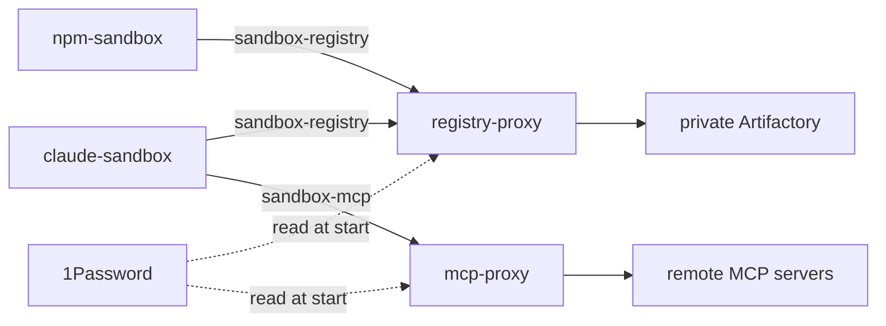
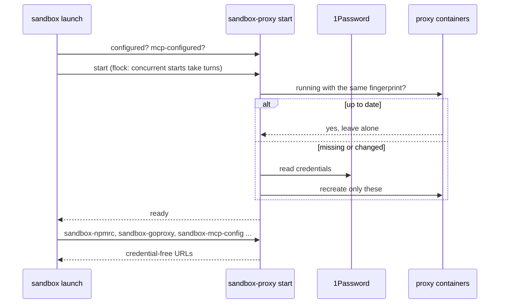

# sandbox-proxy

`sandbox-proxy` (`modules/apps/sandbox-proxy/`) is the credential broker for the
sandboxes. Real credentials are read from 1Password on the host and only ever
handed to proxy containers, which inject them into upstream requests. Sandboxes
get credential-free URLs on host-local podman networks.

| Service | Network | Joined by | Containers |
| --- | --- | --- | --- |
| package registries | `sandbox-registry` | claude-sandbox, npm-sandbox | registry-proxy (caddy), registry-cache (docker pull-through), npm-proxy (Verdaccio) |
| MCP servers | `sandbox-mcp` | claude-sandbox only | mcp-proxy (caddy) |

npm-sandbox runs untrusted install scripts, so it never joins `sandbox-mcp`: a
proxy that acts as you against Jira or Bitbucket must not be reachable from it.

## Starting

Every container carries a fingerprint label of what it was built from except the
secrets (the script, the non-secret config, the Caddyfile). All sandboxes share
one set of containers, so `start` leaves matching ones running: a new session never
cuts off another's in-flight requests, and 1Password is only read when something is
recreated. `sandbox-proxy restart [registry|mcp]` recreates them, for example
after rotating a credential.

## Setup

- Registries: `sandbox-proxy host-login <host> --npm-repo <repo> --go-repo <repo>
  --docker-repo <repo>`, with a 1Password item titled like the Artifactory host
  (username and password fields).
- MCP servers: `sandbox-proxy mcp add <name> --url <url> --op-item <item>
  [--auth basic|bearer]` stores the server (no secrets) in
  `~/.config/sandbox-proxy/mcp-servers.json`. The mcp-proxy serves
  `http://mcp-proxy:8080/<name>` and injects the `Authorization` header. The same
  routes are published on host loopback (`host-mcp-config`) for host tools that
  talk to the servers without a model.
- Anything inside a claude-sandbox can call the MCP proxy as you, so each token's
  scopes are the real limit: keep them read-only. `sandbox-proxy.nix` documents the
  Atlassian (Rovo) token setup.
- The npm cache keeps every tarball fetched; `sandbox-proxy prune [--days N]` (default 60) drops
  npm tarballs unused for N days. Image blobs expire by themselves after 7 days.
