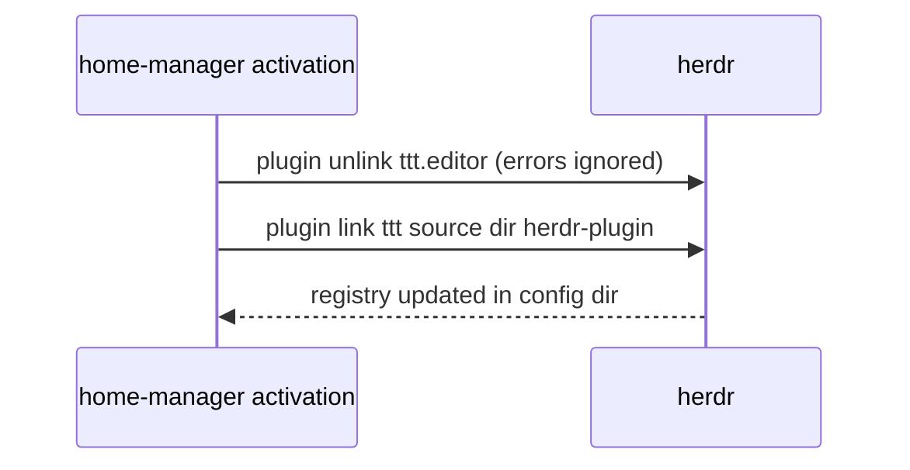

# herdr and ttt

Both are installed from nixpkgs by `modules/apps/herdr/herdr.nix` and
`modules/apps/ttt.nix`, which `profiles/desktop.nix` imports as
`self.nixosModules.herdr` and `self.nixosModules.ttt`. Each NixOS module adds
the package to `environment.systemPackages` and imports its home module for the
primary user (`hostConfig.user.name`).

## herdr

The home module writes `~/.config/herdr/config.toml` (read-only, Nix-owned):

- **Notifications**: `ui.toast.delivery = "system"`. herdr sends a desktop
  notification (`notify-send`) when an agent finishes or needs you in a pane
  you're not looking at. It is the only Claude notifier; Claude Code's own
  terminal notifications are off, and so are claude-tickets' sticky
  `notify-send` pings (`CLAUDE_TICKETS_NOTIFY=0` in Claude's settings `env`,
  `claude-code.nix`).
- **Agent detection**: herdr recognises Claude from a pane's processes. The
  sandbox launcher runs its script as `claude` (`exec -a`) so sandboxed sessions
  are recognised too.
- **Claude integration**: herdr's `herdr-agent-state.sh` is a `SessionStart`
  hook in the Nix-owned `~/.claude/settings.json`, since
  `herdr integration install claude` would be overwritten. It reports the
  session id to herdr; it does nothing inside the sandbox (no herdr socket).
  `session.resume_agents_on_restore = false`.
- **New workspaces**: `terminal.new_cwd = "home"` starts new panes, tabs and
  workspaces in `~`. herdr's default (`follow`) took the focused pane's cwd and
  named the workspace after that folder. `ui.prompt_new_workspace_name = true`
  asks for the name instead.
- **Usage rows**: Claude Code's status line script (`claude-code.nix`) reports
  pane tokens through `herdr pane report-metadata`, one sidebar row each: the
  context token count (`ctx_ok`, `ctx_warn` from 150k in yellow, `ctx_hot` from
  250k in red), how much of the 5-hour and weekly limits is used, as in
  `/usage` (yellow from 80%, red from 95%; a window whose reset has passed
  counts as unused, since Claude only refreshes them on a reply), and a
  countdown to the sooner reset marked with its window (`↻5h 3h44m`,
  `↻7d 2d4h`). The status line re-runs every 60s so the countdown moves.
  In the sandbox the script can't reach herdr (its socket would let the
  sandbox drive every pane), so it writes the tokens to a file in a directory
  mounted from the host, and the launcher, running in the herdr pane, reports
  them every 2s and clears them when the session ends.
- **Startup screens off**: `onboarding = false` (herdr can't record it in a
  read-only file), and `update.version_check`/`manifest_check` off, which also
  stops announcements and release notes. Updates come from nixpkgs.
- **Layouts**: the `local.layouts` plugin, linked on every activation, splits
  the current pane rather than replacing the tab:
  - `prefix+a`: Claude | ttt over a shell
  - no key: Claude | ttt (the plugin's `simple` action)

  ttt opens the left pane's directory; the sandboxed `claude` (by its
  `/etc/profiles/per-user` path) starts in the left pane only when it sits at
  a shell prompt.

## ttt

- **Wrapper**: turns off `log.showSignature` for ttt (signature lines broke its
  `git log` parsing: "Could not read commit"), and appends `gopls`,
  `typescript-language-server`, `vscode-json-language-server` and
  `ttt-prettier` to PATH, after your own.
- **Settings**: ttt rewrites `~/.config/ttt/settings.json` itself, so activation
  merges `lsp.servers` (go, typescript, json) and `formatters` (JS/TS
  extensions: `ttt-prettier {file}`) into it, keeping everything else.
- **Formatting**: Go and JSON format through their servers (`Ctrl+L F`). JS/TS
  also have prettier as the external formatter (`Ctrl+L E`, and on save when
  `editor.formatOnSave` is on): the project's `node_modules/.bin/prettier` if
  found from the file's directory up, else nixpkgs' prettier.

### Plugin registration

The `tttHerdrPlugin` activation step runs after `writeBoundary` on every
activation. The plugin directory is `herdr-plugin/` of the same ttt release as
the installed package (`pkgs.ttt.src`), so plugin and editor stay in step.
`plugin link` fetches nothing and runs no build step, unlike `plugin install`,
which would curl-install a second ttt. Unlinking first makes a changed store path
replace the old link. `local.layouts` is linked the same way.

Alacritty (`modules/apps/terminals.nix`) sets the selection colours (`#f9e2af`
on `#1e1e2e`). Inside Claude Code's fullscreen UI, Claude draws its own
selection; the sandbox passes `TERM`/`COLORTERM` through so it keeps full
colour, and runs with the host timezone (`podman run --tz=local`).
