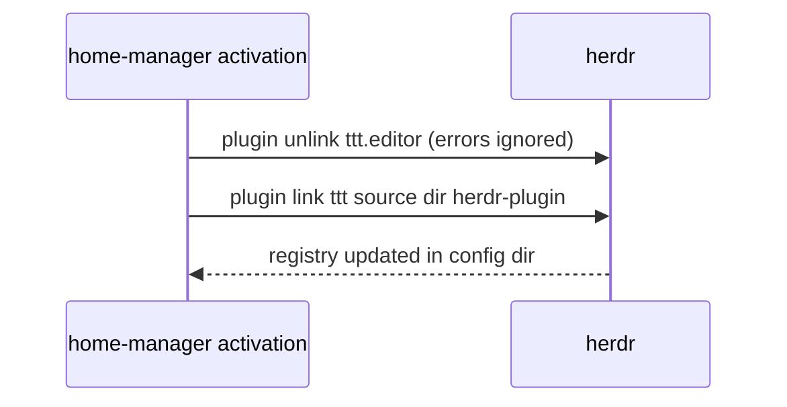

# herdr and ttt

Both are installed from nixpkgs by modules in `modules/apps/`, which
`profiles/desktop.nix` imports as `self.nixosModules.herdr` and
`self.nixosModules.ttt`. Each NixOS module adds the package to
`environment.systemPackages` and imports its home module for the primary user
(`hostConfig.user.name`).

- **herdr** (terminal agent multiplexer): its home module writes
  `~/.config/herdr/config.toml` with `session.resume_agents_on_restore = false`,
  so agent sessions are not resumed after a server restart. No agent integration
  is installed (`herdr integration install claude` is never run).
- **ttt** (terminal editor): its home module registers ttt's herdr plugin.
- Alacritty (`modules/apps/terminals.nix`) sets the selection colours
  (`#f9e2af` on `#1e1e2e`).

## Plugin registration

The `tttHerdrPlugin` activation step runs after `writeBoundary` on every
activation. The plugin directory is `herdr-plugin/` of the same ttt release as
the installed package (`pkgs.ttt.src`), so plugin and editor stay in step.
`plugin link` fetches nothing and runs no build step, unlike `plugin install`,
which would curl-install a second ttt. Unlinking first makes a changed store path
replace the old link.
