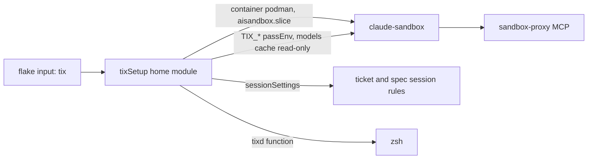
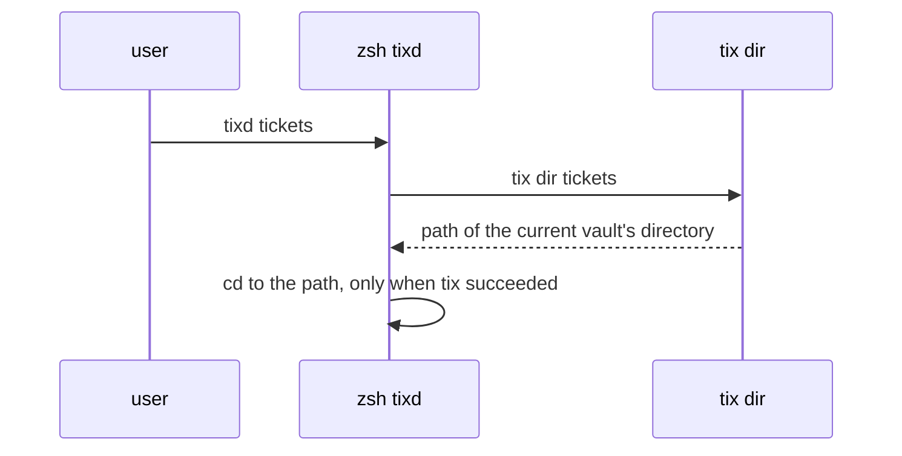

# tix wiring

`modules/apps/tix.nix` provides `flake.homeModules.tixSetup`,
which connects the tix flake input (the ticket workflow and Obsidian
vaults, its own repository) to this machine. tix knows nothing of the
sandbox: here its sessions run the sandboxed `claude`/`kiro`, `tix sync` talks to
sandbox-proxy's MCP servers on host loopback (started on demand), the session
tools are on the sandbox PATH with `TIX_*` passed in, and Claude's LSP tool
comes from `programs.claudeSandbox.lspServers`, not tix.

The input is fetched over ssh with your Bitbucket key. Try local tix changes
with `--override-input tix git+file:///path/to/andy-tix`.

## What it sets

- The sandbox runs in podman under `aisandbox.slice`; `TIX_*`
  variables are passed into it and the model cache under
  `$XDG_CACHE_HOME/tix/models` is mounted read-only so `tix vault search`
  finds its models. Fetch them on the host first (`tix vault model fetch`); a
  missing cache is skipped with a log line.
- Ticket and spec sessions commit on their branches, signed through
  git-ssh-broker's agent, and push through the broker, which refuses branch or
  tag deletes and force pushes, except a rewrite of a `feature/*` branch that
  drops only your own commits (so the autopilot can rebase its ticket branch
  after a conflict and `git push --force-with-lease` it). The lead pushes after
  each wave, so Bitbucket Pipelines scans every wave and the PO routes failures
  back; `/tix:save` pushes at the end.
- Sessions run with `SANDBOX_GIT_AUTOSIGN=0`: ticket work is committed unsigned
  and signed in batches (`tix ws resign` before each wave's push and after the
  tidy), so the signing agent asks once per push and a locked agent never stalls
  a wave. The agent and key stay in the session for that step.
- `tix ws cleanup`, `tix ws resign` and `tix board` are allowed without a
  question because they check before changing (a clone or ref only once its
  commits are kept elsewhere, a branch only to the same tree, a board line under
  a lock); forced forms (`tix ws tidy-clean --force`) still ask.
- `sessionSettings.permissions.deny` adds the rules those sessions never get
  (`git reset --hard`, `git branch -D`, ...), on top of tix's own
  (the graph cache read-only; spec sessions also stay out of the repos). The
  workspace settings file is read-only in the sandbox, so a session can't relax
  them.
- Exception to that deny list: the lead adds and removes git worktrees, one per
  task under the ticket workspace's `tasks/`, and removes each once its branch
  is merged, deleting the branch ref with `git update-ref -d` after checking
  it is merged (`git branch -d` would write the main clone's read-only config;
  `-D` stays denied).
- Ticket sessions compact by themselves at 200k, from the `autoCompactWindow`
  every Claude home gets (`modules/apps/claude/claude-code.nix`). The PO writes
  its state to its board and relay as it changes, so compaction loses nothing,
  and tix's SessionStart hook resumes from the board; 200k keeps a PO's context
  short of where it stops paying for itself.
- Rovo tools that consume paid credits are denied.
- `SANDBOX_*` set in the shell that runs `tix` reach that one session (claude's
  or kiro's sandbox), because the session runs in the foreground of that shell
  and inherits its environment: `SANDBOX_PORTS=3000 tix start PROJ-12`. tix adds
  the directories a session needs to `SANDBOX_ADD_DIRS` and the model cache to
  `SANDBOX_RO_PATHS` itself.
- Vaults whose `.workflow.json` says `"agent": "kiro"` (or `TIX_AGENT=kiro`,
  `--agent kiro`) run their sessions in the kiro sandboxes: `programs.tix.kiro =
  "kiro"`. `AGENT=<profile>` picks the claude or kiro account for either
  ([agents](./agents.md)); tix doesn't need to know. tix renders its plugin
  into the workspace's `.kiro/` and runs `kiro chat --agent tix`. The kiro
  sandbox passes only listed variables, so tix sets `GOPATH`, `GOMODCACHE` and
  `GOCACHE` in the session environment (Claude reads them from the workspace's
  `settings.json`); without them `go` writes to the asdf install's read-only
  module cache.
- PowerShell is in the sandboxes because repos whose tooling ships `.ps1` next to
  `.sh` have tests for both.
- `tix ws diff` opens diffnav in a terminal, the one this machine installs
  (`modules/apps/diffnav.nix`; tix ships none, and 0.12 starts with its
  file filter focused so `q` doesn't quit); its look (Catppuccin Mocha to match
  alacritty's selection colours, Nerd Font icons, no header, a wider file tree
  for the repo folders) is `~/.config/diffnav/config.yml` from
  `modules/apps/diffnav.nix`. `T` in diffnav previews the other themes for
  that run only; the file is read-only.
- `tixd work|tickets|repos` is a zsh function: it runs `tix dir <arg>` and `cd`s
  to the printed directory (a command can't change the shell's directory).

## Flow: opening a directory

